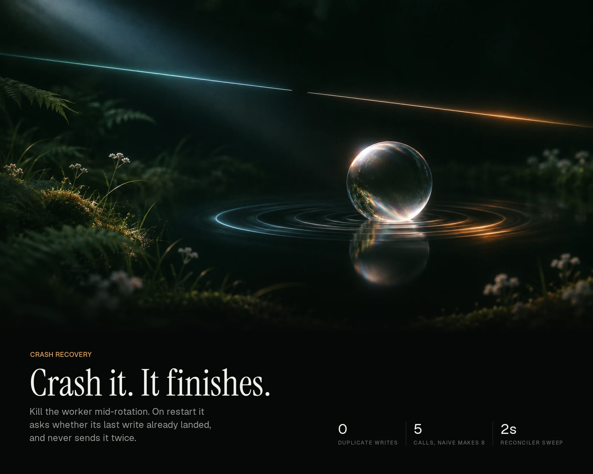
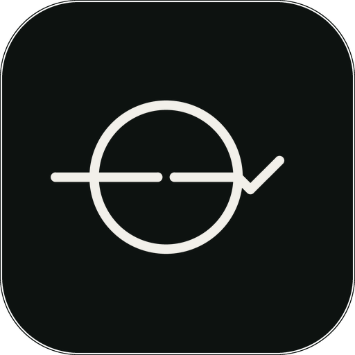

# Design language

How Incident Recovery Agent looks and sounds: the dashboard, the proof view, the README, slides and the demo video.
Inspired by Perplexity's brand and ads: quiet night scenes, one calm object, a single thread of warm light.

This is a guide, not code. Nothing in `web/` has been changed to match it yet; the
[mapping table](#from-todays-dashboard) shows where today's tokens would go.

<div align="center">
  
</div>

---

## 1. Principles

1. **Night, not neon.** Near-black greens and warm whites. Colour is light falling on something, never a glow for
   its own sake.
2. **One light per view.** Each screen has one warm amber accent: the thing that matters right now. Everything else is
   grey until it needs you.
3. **Proof over decoration.** Every pixel should help someone trust what happened: states, ids, timestamps,
   receipts. If an element proves nothing, it goes.
4. **Calm under failure.** A crash is shown, not shouted. Errors are clear and specific, never flashing red banners.
5. **Nothing happens twice.** The visual motif is one unbroken thread: it can pause (a gap), but it resumes on the
   same line. Use it for timelines, loaders and the logo.

---

## 2. Logo

<div align="center">
  
</div>

A thin circle (the ledger) with one thread passing through it. The thread breaks once in the middle (the crash) and
carries on along the same line (it resumes, nothing repeated), then turns up into a check (verified).

| Asset | Use |
|---|---|
| `docs/images/logo.png` | Mark on a dark tile. README, favicon, slides. |
| `docs/images/logo-mark.png` | White mark on transparent. Over photos and dark UI. |
| `docs/images/logo.svg` | The vector source. Favicon and any size in the web UI (`stroke` is `--ink`). |

- Keep clear space around the mark of at least half its width.
- Always white (`--ink`) on a dark surface. Never recolour it, add a glow, or put it on a light background.
- The wordmark is "Incident Recovery Agent" in Geist Regular, sentence case, beside the mark. Never all caps.

---

## 3. Colour

All colours are defined on dark. There is no light theme.

### Surfaces and text

| Token | Hex | Use |
|---|---|---|
| `--night` | `#060807` | Page background, the black under photos |
| `--forest` | `#0D1210` | Panels, cards |
| `--moss` | `#141B18` | Raised panel, hover, selected row |
| `--hairline` | `#FFFFFF14` | Borders and dividers (white at 8%) |
| `--hairline-strong` | `#FFFFFF24` | Focus rings at rest, input borders |
| `--ink` | `#F2F0EA` | Primary text, numbers, the logo |
| `--sage` | `#969A94` | Secondary text, body copy on dark |
| `--fog` | `#62665F` | Labels, captions, timestamps, disabled |

### Light

| Token | Hex | Use |
|---|---|---|
| `--amber` | `#E8A252` | The one accent: primary action, current step, links on hover, the thread |
| `--amber-soft` | `#E8A2521F` | Amber fill behind a selected or current item |
| `--dusk` | `#7FA7D9` | Cool light: in-flight work, the reconciler, focus |

### Ledger states

Every action state has one colour, used for its badge, its bar segment and its node in the proof DAG. They are
muted so a screen full of them stays calm; only the current step is bright.

| State | Token | Hex | Meaning on screen |
|---|---|---|---|
| `intended` | `--state-intended` | `#6E746F` | Planned. Grey, quiet. |
| `sent` | `--state-sent` | `#7FA7D9` | Call made, waiting. Dusk blue. |
| `receipt` | `--state-receipt` | `#D9B26A` | Acknowledged, not yet checked. Pale gold. |
| `verified` | `--state-verified` | `#8DBF86` | Independently confirmed. Moss green. |
| `unknown` | `--state-unknown` | `#6FB7B0` | We can't tell yet. Mist teal, breathing slowly. |
| `failed` | `--state-failed` | `#E0705C` | Rejected or proven wrong. Ember, never neon red. |

Rules:
- State colour is always paired with the state's name in text. Colour alone never carries meaning.
- No purple, no pink, no saturated cyan, no gradients on UI elements. Gradients belong in photos only.
- Body text on `--forest` must be `--sage` or brighter (WCAG AA). `--fog` is for labels 12 px and up, never body.

---

## 4. Type

| Role | Family | Use |
|---|---|---|
| Display | **Instrument Serif** Regular | Hero headlines, section titles in the README and slides, empty-state titles. 40 px and up only. |
| Text | **Geist** Regular / Medium | Everything else: UI, body, buttons, numbers. |
| Mono | **Geist Mono** (or IBM Plex Mono) | Action ids, campaign ids, payloads, logs, code. |

All three are free on Google Fonts. Fallbacks: `Georgia, serif`, `system-ui, sans-serif`, `ui-monospace, monospace`.

### Scale

| Token | Size / line | Weight | Use |
|---|---|---|---|
| `--t-hero` | 64 / 1.0 | Serif | Page hero, poster headline |
| `--t-title` | 40 / 1.05 | Serif | Section title, empty state |
| `--t-h1` | 20 / 1.3 | Geist Medium | Panel title, campaign name |
| `--t-body` | 15 / 1.55 | Geist Regular | Body |
| `--t-small` | 13 / 1.45 | Geist Regular | Secondary rows, metadata |
| `--t-label` | 11 / 1.2 | Geist Medium, uppercase, `letter-spacing: .12em` | Stat labels, panel kickers |
| `--t-stat` | 32 / 1.0 | Geist Regular, `tabular-nums` | Big numbers |
| `--t-mono` | 12.5 / 1.45 | Mono | Ids, payloads |

- Sentence case everywhere. Uppercase only for `--t-label`, always letter-spaced.
- Numbers are always Geist with `font-variant-numeric: tabular-nums`, never the serif.
- Headlines are short statements with a full stop: "Crash it. It finishes."

---

## 5. Space, shape and depth

- **Spacing:** a 4 px base. Use 4, 8, 12, 16, 24, 32, 48, 64. Panels pad 16-24; sections breathe 48-64.
- **Radius:** 6 px for badges and inputs, 12 px for panels, 999 px for pills. Nothing sharper, nothing rounder.
- **Borders over shadows.** Depth is a 1 px `--hairline` and a step up in surface (`--forest` → `--moss`). No drop
  shadows in the UI.
- **Glass, sparingly.** A panel floating over a photo may use `background: #0D121099; backdrop-filter: blur(16px)`
  with a `--hairline` border. Never glass on glass.
- **Grain.** Large photo areas and hero sections carry a faint film grain (2-3% noise overlay). UI panels do not.

---

## 6. Components

**Header.** `--night` background, logo mark + wordmark on the left, a live pill on the right. One hairline below.
No filled bar colour.

**Panel.** `--forest`, 12 px radius, hairline border. Title in `--t-h1`, an optional `--t-label` kicker above it in
`--fog`. Rows are separated by hairlines, not gaps.

**State badge.** Pill, 6 px radius, 1 px border in the state colour at 50%, text in the state colour, fill at 8%.
The current step's badge is the only one at full fill (`--amber-soft` + amber text if it's the active step).

**Stat block** (from the posters). Value in `--t-stat` `--ink`, label under it in `--t-label` `--fog`. Several stats
sit in a row separated by 1 px vertical hairlines, right-aligned in their area.

```
0                 │ 5                     │ 2s
DUPLICATE WRITES  │ CALLS, NAIVE MAKES 8  │ RECONCILER SWEEP
```

**Thread timeline** (an action's transitions). A single 1 px line in `--hairline-strong` with a dot per state.
Reached states fill with their colour; the current dot is amber with a soft 8 px halo. A crash is drawn as a small
gap in the line, then the line continues. Timestamps sit under each dot in `--t-mono` `--fog`.

**Proof DAG.** Nodes are 12 px radius cards on `--forest` with a 2 px left edge in the state colour. Edges are 1 px
`--hairline-strong` curves; the edge into the current node is amber.

**Buttons.** Primary: `--ink` text on `--moss`, hairline border, amber border on hover and focus. Only one primary
per view. Secondary: text only in `--sage`, `--ink` on hover. No filled amber buttons except the single hero CTA.

**Links.** `--ink` with a 1 px `--fog` underline offset 3 px; underline turns amber on hover.

**Live indicator.** Pill with an 6 px dot: `--state-verified` when the change stream is connected, `--fog` when not.
The dot breathes (opacity 1 → .5, 2.4 s). No ripple rings.

**Comparison (naive vs. ledger).** Two columns, same structure. Duplicates are `--state-failed` text with an
"x2" count; the ledger side shows "x1" in `--ink`. The verdict sits under each in a panel with a 2 px left edge,
never a filled red/green box.

**Empty state.** One line of Instrument Serif at `--t-title` in `--sage`, one line of `--t-small` under it. No
illustrations, no emoji.

---

## 7. Motion

- Slow and deliberate. Durations 200-400 ms, `cubic-bezier(.2, .7, .2, 1)`. Long-exposure feel, never bounce.
- **State change:** the badge cross-fades to the new colour and the thread draws forward to the next dot (300 ms).
- **New row:** fades in and slides up 4 px. The background flashes `--amber-soft` once, 1.2 s ease-out.
- **Unknown:** breathes (opacity 1 → .55, 2.4 s). Never blinks.
- **Crash:** the line stops, a short gap appears, the next segment starts on the same line after the restart.
- Respect `prefers-reduced-motion`: replace all of the above with instant changes.
- Never animate font size or letter spacing.

---

## 8. Imagery

Photos set the mood; the UI stays plain. Every promo image follows the same brief (used to generate the README
images with ChatGPT image generation):

- Cinematic, analog-film photography of quiet nature at night or blue hour: moss, ferns, wild grass, small white and
  yellow wildflowers, still black water.
- One calm, surreal hero object: a clear glass sphere, a key, a droplet. Prismatic edge highlights, soft halo.
- Long-exposure light streaks in muted blue fading to warm amber. Soft volumetric beams.
- Fine grain, gentle halation, shallow depth of field, lots of negative space.
- Never: neon, purple gradients, cyberpunk, robots, circuit boards, holograms, padlocks, shields, UI screenshots,
  3D-render plastic, text baked into the photo.

**Poster layout** for any image that needs to explain something: the photo fades into `--night` at the bottom; a
`--t-label` kicker in amber, an Instrument Serif headline in `--ink`, two or three lines of Geist body in `--sage`
bottom-left; a stat row bottom-right. See `docs/images/crash.webp`, `rotate.webp`, `recall.webp`.

**Banners** are 3:1, the sphere holding the logo mark, the wordmark beside it.

---

## 9. Voice

- Plain, short, specific. Say what happened, with the number: "Updated 3 repos. 1 found mid-run."
- Present tense, active voice, sentence case. No exclamation marks, no emoji in the product.
- "Verified" only ever means `verify()` confirmed it. Never use it for "sent" or "probably fine".
- Errors say what we know and what happens next: "Can't tell if the secret update landed. Checking again in 15 s."
- Name things the way the code does: campaign, action, playbook, receipt, verified.

---

## 10. Tokens

For whoever restyles `web/` later, as plain CSS custom properties:

```css
:root {
  /* surfaces + text */
  --night: #060807;  --forest: #0D1210;  --moss: #141B18;
  --hairline: rgba(255,255,255,.08);  --hairline-strong: rgba(255,255,255,.14);
  --ink: #F2F0EA;  --sage: #969A94;  --fog: #62665F;
  /* light */
  --amber: #E8A252;  --amber-soft: rgba(232,162,82,.12);  --dusk: #7FA7D9;
  /* ledger states */
  --state-intended: #6E746F;  --state-sent: #7FA7D9;  --state-receipt: #D9B26A;
  --state-verified: #8DBF86;  --state-unknown: #6FB7B0;  --state-failed: #E0705C;
  /* type */
  --font-display: "Instrument Serif", Georgia, serif;
  --font-text: "Geist", system-ui, sans-serif;
  --font-mono: "Geist Mono", ui-monospace, monospace;
  /* shape + motion */
  --r-sm: 6px;  --r-md: 12px;  --r-pill: 999px;
  --ease: cubic-bezier(.2,.7,.2,1);  --dur: 300ms;
}
```

### From today's dashboard

| `web/index.html` today | Becomes |
|---|---|
| `--bg #0b0e14` | `--night` |
| `--panel #131824` | `--forest` |
| `--panel-2 #1a2030` | `--moss` |
| `--line #252d40` | `--hairline` |
| `--text #e6e9f0` | `--ink` |
| `--muted #8b93a7` | `--sage` (body), `--fog` (labels) |
| `--accent #6ea8fe` | `--amber` |
| `--intended / --sent / --receipt` | `--state-intended / --state-sent / --state-receipt` |
| `--verified #3ecf8e` | `--state-verified` |
| `--unknown #c084fc` (purple) | `--state-unknown` (mist teal) |
| `--failed #f26d6d` | `--state-failed` |
| System font stack | Geist, with Instrument Serif for titles |
| `.badge.s-unknown` blink | Slow breathe |
| `.live .dot` ripple | Slow breathe |

---

## 11. Do and don't

| Do | Don't |
|---|---|
| One amber accent per view | Several bright colours competing |
| Hairlines and surface steps for depth | Drop shadows, glows, neon |
| State name + colour together | Colour as the only signal |
| Serif for big statements, Geist for everything else | Serif for numbers, UI or small text |
| Real numbers from the run | Vague claims ("blazing fast", "AI-powered") |
| Photos of quiet nature with one object | Stock tech imagery, robots, padlocks |
